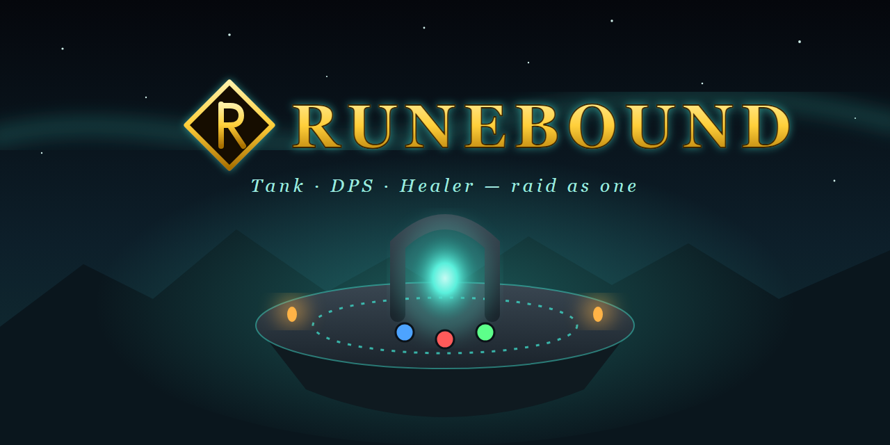

**Play in your browser:** https://aurakingstudio.github.io/Runebound/

# Runebound (solo prototype)

- **Quickest:** double-click `index.html` (works offline, everything is embedded).
- **Windows .exe:** double-click `build-exe.bat` (needs Node.js). The .exe appears in `dist/`.
- **Desktop app / .exe (manual):** install Node.js, then in this folder run `npm install` and `npm start`.
  For a Windows portable .exe run `npm run dist` (build it on Windows; the file appears in `dist/`).
- Progress (gold, upgrades, quests) is saved in the browser/app storage.
- Press **Esc** or **P** (or use Pause) to pause. The optional, compact AdSense slot appears only in this menu.
- For web release, edit `ads-config.js` with the approved AdSense publisher and pause-slot IDs, set `enabled: true`, and deploy over HTTPS. Finish AdSense site approval and consent-message setup first. Ads are intentionally disabled in the offline file and Electron app.
- Upload `Runebound-itchio.zip` to itch.io as an HTML5 game. Its files are at the ZIP root.

## Automatic player-hosted hub pilot

The browser automatically requests a seat after the player name is set. The dependency-free signaling directory assigns the first available hub, in numeric order; each player-hosted hub has up to 10 players, and the directory permits up to 10 hubs. The first player assigned to an empty hub hosts its gameplay. This pilot syncs hub movement and chat only; raid combat, host migration, reconnect recovery, authenticated accounts, and a public profile trust system are not implemented.

### Configure and run the directory

The rendezvous service is plain Node.js using built-in modules—no new npm package is required:

1. Run `node signaling-server.js` on a machine reachable by players (default port 8787), or set `PORT`.
2. Deploy it behind HTTPS for internet use. Set `ALLOWED_ORIGINS` to a comma-separated allowlist containing the game's exact origin, such as `https://aurakingstudio.github.io`. GitHub Pages serves the game files but does not run this service.
3. Set `signalingUrl` and, if needed, `iceServers` in the `NETWORK_CONFIG` constant in `index.html`. For this temporary test, the URL is a Cloudflare Quick Tunnel to the local service; it only works while the tunnel and service are running on the host PC, and changes when restarted. Use a named Cloudflare Tunnel and stable domain for a longer-lived host. Never commit private TURN credentials to this public repository.
4. Open the game in two browser profiles/devices and set a distinct local player name in each. The game automatically attempts to assign each player after their name is set. The HUD shows the hub number and why that hub was selected; the first player hosts. After 10 seats, the next player is assigned to the next available hub.

The directory stores temporary hub assignments and WebRTC offer/answer data in memory only. It does not receive local save data or simulate the game. A server restart clears sessions. Browser WebRTC encrypts peer traffic in transit; directory bearer tokens are temporary secrets. Host-side checks limit profile shape, movement input, dash frequency, and message rate, but a player-controlled host can still cheat and these checks are not a guarantee of integrity. Shared display profiles are player-supplied, not verified account records.

The host simulates guest movement at 20 ticks/second and sends snapshots at about 10 per second. Clients predict their own movement, interpolate remote movement behind by a short buffer, and smoothly correct smaller errors while snapping larger ones. The host selection for now is “first player in an empty hub”; PC/console/phone ranking and host migration are not implemented.

All browser-side networking, configuration, and game integration live in `index.html`. `signaling-server.js` is the separately runnable rendezvous service because it must run under Node.js. The game rules can later use a dedicated-server transport instead. Run `node test/dev.test.js` for game, transport, and signaling-directory regression tests.
